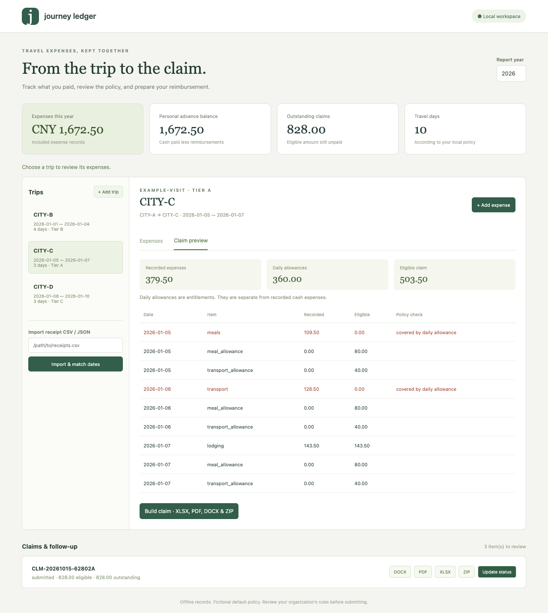

# Expense Claim Helper

A local travel expense workspace that connects itineraries, receipts, fictional travel policies, and reviewable claim documents. Runs offline after installation. No paid API, account, telemetry, company integration, or invoice authenticity check.



## Start in three commands

Python 3.11 or later is required. From this repository:

```sh
python3 -m venv .venv && .venv/bin/python -m pip install -e '.[dev]'
ECH_DATA_DIR=data/demo .venv/bin/python examples/seed_demo.py
.venv/bin/ech --data-dir data/demo serve
```

Open <http://127.0.0.1:8898>. The demo contains three fictional itineraries and a real OCR export from ten generated fictional receipts. An additional duplicate is excluded by default, and an intentionally mismatched lodging expense demonstrates review. Repeat seeding safely: identical items are reused. All cities, vendors, invoice numbers, and policy rates are invented.

For an empty workspace, use `ech --data-dir data/private serve`. On some macOS environments, hidden editable-install `.pth` files must be made visible: `chflags nohidden .venv/lib/python3.*/site-packages/*.pth`.

## What you can do

- Record timed trips, destination tiers, participants, classes, expenses, receipts, and payment sources.
- Import [receipt-ocr-csv](https://github.com/GuoHaoyu1688/receipt-ocr-csv) CSV or JSON. Match only unambiguous date windows, preserve duplicate flags, and review unmatched or excluded records.
- Calculate exact integer-cent allowances, lodging caps, required receipts, class restrictions, and employee differences.
- Generate actual XLSX, PDF, DOCX, and ZIP claim packages with detail rows, totals, signature placeholders, numbered receipt references, a policy snapshot, and SHA-256 attachment manifests.
- Track submission, approval, partial or full reimbursement, reminders, outstanding claims, and employee advance balance.
- View mobile-friendly trip lists, enter expenses, preview remaining items, download reports, and update statuses in the local Web UI.
- Export native JSON/CSV archives, readable expenses, or ledger cash flows; restore a portable archive into an empty workspace; create timestamped backups.
- Use six MCP tools through the official Python SDK. [AGENTS.md](AGENTS.md) contains the complete noninteractive interface.

## An example claim

```sh
.venv/bin/ech --data-dir data/demo check --json
.venv/bin/ech --data-dir data/demo claim preview --trip 1 --json
.venv/bin/ech --data-dir data/demo claim build --trip 1 --format xlsx,pdf,docx,zip --json
.venv/bin/ech --data-dir data/demo claim list --json
```

Review warnings before submitting any claim. Receipt validation findings are included in preview and frozen report flags, separately from policy eligibility; CLI/MCP warning envelopes retain them. The built files live under `data/demo/claims/<claim-code>/`. Files and receipt bytes are frozen at creation. Status changes update the tracker; previously generated documents retain their original creation status. Building the same exhausted scope returns the existing claim, and can add previously unrequested formats without rewriting existing artifacts. New expenses produce a new claim containing only remaining items. Claiming a month splits daily allowances by local calendar date; expense rows belong to their entered dates.

```sh
.venv/bin/ech claim status CLM-20261015-ABC123 submitted --date 2026-10-16
.venv/bin/ech claim status CLM-20261015-ABC123 approved --date 2026-10-17
.venv/bin/ech claim status CLM-20261015-ABC123 paid --amount 250.00 --date 2026-10-20
.venv/bin/ech due --as-of 2026-11-20 --json
```

Replace the example code with a real generated code. `--amount` is **cumulative money received**, so a later `300.00` records only another `50.00`. Repeating an unchanged transition is idempotent. The sequence is unsubmitted → submitted → approved → paid; partial payment retains a positive outstanding amount and remains eligible for overdue reminders.

## Policy and calculation rules

The initial `data/policy.yaml` is copied from the fictional default. Edit it before generating claims. The complete example is [examples/policy.yaml](examples/policy.yaml). No rate is a legal or organizational recommendation.

| Tier | Lodging / person / night | Meals / person / day | Local transport / person / day |
| --- | ---: | ---: | ---: |
| A | 400.00 | 80.00 | 40.00 |
| B | 300.00 | 60.00 | 30.00 |
| C | 200.00 | 50.00 | 20.00 |

The default half-day rule uses the configured local timezone. A same-day trip of at most six hours earns half a day, otherwise one day. For a multiday trip, departure at or after noon earns half a day; return at or before noon earns half a day; intermediate dates earn one day. `calendar_day` can replace this rule. Overlapping trips are rejected. Distinct trips on one date share at most one allowance day, assigned chronologically within a selected claim scope; previously claimed units take precedence. Annual travel-day statistics apply the same one-day cap, without multiplying by participants.

Lodging eligibility is `min(actual, tier cap × nights × participants)`. Classes must match the allowed flight/train list. Required missing receipts make that expense ineligible. Company-paid rows have zero employee reimbursement. Meal/local transport `allowance` mode adds daily allowance rows and sets corresponding actual-expense reimbursement to zero; `actual` mode reimburses actual eligible rows instead. Half-cent allowance results are rounded down per trip/date after participant multiplication.

**Self-paid difference is computed per actual expense before allowances.** It does not subtract the separate daily allowances and is not the final net personal cost. `advance_balance` is included employee cash expenses minus recorded receipts of reimbursement, floored at zero; it is distinct from eligible unpaid claims. Excluded duplicates contribute to neither claims, expense statistics, nor cash-flow exports. An explicit review can include them again.

Six independently calculated acceptance cases cover half days, full days, cross-month/year travel, different tiers, participants, lodging caps, and class rules. A cross-month tier-B trip from January 30 at 15:00 to February 2 at 10:00 earns three days and 270.00 allowance. A 760.00 two-night lodging expense yields 600.00 eligible and a 160.00 difference. Total claim eligibility is 870.00, split 735.00 in January and 135.00 in February.

## Data, imports, and backups

`--data-dir` overrides `ECH_DATA_DIR`, which overrides `./data`. All paths may be selected at runtime. SQLite contains records; `receipts/` contains copied originals; `claims/` contains frozen sources and reports. Default timezone is `Asia/Shanghai`; offset-aware trip input is converted to that timezone.

A configuration file is read from `data/config.yaml` or `--config PATH`:

```yaml
timezone: Asia/Shanghai
policy_file: policy.yaml
unsubmitted_days: 14
unpaid_days: 30
max_receipt_mb: 30
```

Receipt CSV fields include `date,amount,tax,currency,vendor,category,invoice_no,file,duplicate_of,id`. Relative file paths resolve beside the CSV. The source tax value remains in the original OCR export; this helper claims the supplied inclusive total and does not recalculate tax. Same-date multiple-trip matches remain unmatched. Use `expense review ID --trip ID` after inspection. File hashes and stable row identities prevent duplicate ingestion.

```sh
.venv/bin/ech import-receipts examples/receipts.csv --auto-match --json
.venv/bin/ech export --format csv --kind expenses --out output/expenses.csv
.venv/bin/ech export --format csv --kind ledger --out output/cash-flows.csv
.venv/bin/ech export --format json --out output/archive.json
.venv/bin/ech --data-dir data/restored import output/archive.json
.venv/bin/ech backup
```

CSV defaults to UTF-8 BOM. Native archives contain tables and original bytes; CSV archives use `entity,payload` rows, distinct from readable expense/ledger exports. Restore requires an empty library; identical archive reimport is a no-op. Backup ZIPs contain SQLite, effective configuration, policy, receipts, claims, and `portable.json`. Extract and import `portable.json` for a different filesystem location. Use a fresh default configuration when restoring; custom external policy paths are not relocated. Backup before manual database, policy, or filesystem changes. Existing exports require explicit `--yes` to overwrite.

## Verification and limitations

```sh
.venv/bin/ruff check .
.venv/bin/ruff format --check .
.venv/bin/pytest --cov=expense_claim_helper --cov-report=term-missing
```

The test suite verifies all six MCP tools and an actual stdio client, CLI/HTTP error boundaries, six manual calculation cases, immutable snapshots, repeated imports/claims, partial payments, receipt integration, portable restores, XLSX totals, DOCX/PDF structure, and ordered ZIP attachments. [docs/validation.json](docs/validation.json) records local results. CI runs Ruff and pytest on Ubuntu with Python 3.11 and 3.12. Locally verified on macOS with Python 3.12; CI status is separate from this local result.

One currency per library; no FX conversion, invoice authenticity checks, company submissions, bank connections, OCR, network notifications, or multi-user login. Reminders are computed when queried. Itineraries represent one employee/group and cannot overlap. Editing a claimed expense is blocked; corrections require a separate explicit adjustment workflow outside this version. Approval history cannot be reversed. Unlimited company policy languages, tax handling, pooled group per diems, and split-night allocations are outside scope. The built-in PDF font supports Latin text; use English city codes for PDF output. Use DOCX/XLSX for Unicode records. Receipt copying/restoration requires POSIX `O_NOFOLLOW` (Linux/macOS); Windows is not supported in this release.

Roadmap: explicit reversible adjustment claims, configurable Unicode PDF fonts, and optional organization-specific document templates. MIT licensed.
